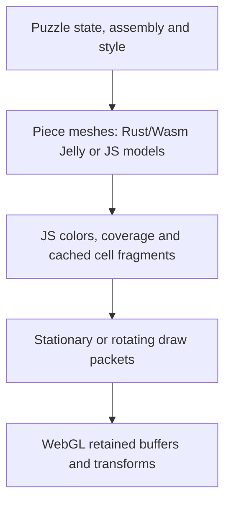

# Rendering audit: Jelly

## Findings and measurements

CPU fragment preparation, especially JavaScript clipping/capping, dominated the sampled connected Jelly piece. Rust mesh generation is significant but was not the largest measured stage. GPU performance and whole-app latency remain unmeasured.

Device: AMD Ryzen 7 3700X 8-Core Processor, win32/x64, Node v25.3.0.

| Shape/settings | Native mesh (ms) | Composite incl. native (ms) | Fragment preparation (ms) |
| --- | ---: | ---: | ---: |
| Jelly L, 100% | 18.2 | 44.2 | 342.2 |
| Jelly L, 40% | 37.3 | 90.4 | 594.2 |
| Jelly L, profile 6 | 57.6 | 86.6 | 373.5 |
| Jelly single cubie | 3.0 | 12.1 | 0.3 |

These are medians of five samples using release Wasm in Node, after a Wasm warmup. Each cold case uses a fresh piece-cache module. Composite includes native generation: do not add those two columns together. These are individual CPU stages, not browser frame times or full-packing measurements. Five samples are insufficient for a dependable p95.

See [raw samples](geometry-baseline.json) for runtime/device, maxima, mesh bytes, triangle counts and Wasm SHA-256. Reproduce after building with `npm run bench:geometry`.

## Architecture

- **Jelly — crates/puzzle-core/src/mesh.rs:** Builds a smooth scalar occupancy field over each piece and samples a regular 3D lattice. Marching tetrahedra extracts triangles. Shared crossing edges undergo ten field-refinement iterations; normals use six additional field evaluations per unique sampled vertex. The field includes powers and exponentials. Corner-O instead uses an 80 by 40 parametric surface. Output is unindexed triangles, with position, normal and RGB: nine floats per vertex.
- **Transport and coloring — web/engine/transport.js and web/render/piece-mesh.js:** Wasm runs synchronously and its result is copied. Raw and colored caches retain meshes. The coloring path builds growable JS arrays before converting to Float32Array, and attaches transparency coverage.
- **Turn preparation — web/render/cell-fragments.js and slice-mesh.js:** Repeated triangle clipping against cubie boundaries creates closed pieces. Intersection points are welded, boundary loops assembled, and caps triangulated. This uses many arrays, string keys and maps. Closed caps are needed to show newly exposed surfaces during a turn.
- **Animation — web/explorer/cube-view.js:** A state signature decides when to rebuild. Motion buffers are prepared lazily for an axis/layer partition; subsequent animation frames apply GPU rotation matrices. Turn completion may require new detection/assembly and new fragments. Retained assembly preserves the original cut pieces; whole-piece assembly can rebuild currently detected shapes. These are different visual semantics and must stay distinct. The game renderer shares mesh helpers and the packet pipeline.

## Confirmed defect and applied correction

The explorer called `joinMeshes(compositeParts(...))` for complete four-cell pieces. Even when there was only one cached part, joining copied it into a new array. The fragment cache keys on array identity, so it recut identical geometry after a state/signature rebuild.

`web/explorer/exploration-mesh.js` now returns the cached part directly when there is one part. Multiple parts still join normally. Geometry remains immutable. The regression test covers identical-state reuse, unchanged geometry and coverage, closed-fragment reuse, and invalidation on color/size changes.

Repeated preparation of the same L-shaped piece: **351.04 ms median** with the previous copy path; **0.16 ms** with preserved identity. This includes explorer piece lookup and fragment-cache access, not full rendering.

The benchmark reproduces the previous copy path alongside the fixed path. This improvement applies to geometry still in cache. It does not remove cold generation, all uploads, or genuinely new shapes after turns.

## Why these interactions lag

1. Jelly geometry changes invalidate the geometry/style keys, regenerate surfaces and recut fragments. These sliders already commit expensive changes on release, rather than every input tick. Ordinary input debouncing is not the main missing optimization.
2. Packing selection changes masks and positions, missing raw, colored or fragment caches. The fixed identity bug also forced unnecessary clipping on otherwise reusable geometry.
3. A turn needs caps and motion buffers; the final state can produce newly detected shapes.
4. Reducing cubie scale shrinks the sampling step while retaining broad grid bounds. At 40% scale, comparable bounds can contain about 15.6 times as many lattice samples. This is not a prediction of 15.6 times runtime; the measured fragment cost nevertheless increased substantially.
5. Caches do not share a session memory budget. Raw geometry is limited to 192 entries; colored geometry budgets 16 MiB and fragments 24 MiB. These counters omit attached coverage arrays and some retained source memory. Eviction is generally insertion-order, not true LRU. This justifies measuring churn and retained resources; it does not prove a leak.

## Recommended next architecture, in priority order

### Full preparation service in a dedicated worker

Move the entire CPU sequence—mesh generation, clipping/capping—off the main thread. Moving only native Jelly generation leaves the largest measured stage blocking input.

Send immutable topology, geometry settings and a revision. Return transferable typed arrays. Accept only the current revision, then upload and draw on the main thread. Use a separate Wasm instance for geometry, without racing the live game engine's memory. Keep the previous valid scene while its replacement is prepared; coalesce requests and bound the queue.

Sending cancellation messages does not interrupt synchronous Wasm already running. Initially cancellation means dropping queued work and stale output, or terminating an owned worker when justified. Define transfer ownership so transferring a result does not accidentally detach cached buffers. A worker improves responsiveness, not necessarily total computation time.

Instrument stage duration, cache hit/miss/eviction counts, transferred bytes, upload bytes and input-to-present latency before and after this change.

### Reduce fragment work and preserve stable geometry identity

Keep cached meshes/fragments stable through assembly. If profiling confirms allocations dominate clipping, move that operation into efficient typed-array/native code. Consider generating cell-owned surfaces and caps directly, avoiding repeated clipping; preserve concave loops, watertight cuts and coverage anchors with the existing geometry tests.

Separate geometry from RGB where feasible. Cache canonical shapes under proper cube rotations/translations, preserving chirality. Retained cuts and newly detected whole pieces require different keys; do not reuse a nominal tetromino mesh for an arbitrary disconnected fragment.

### Bound quality and retained resources

Separate quality from cubie size. Use measured error limits or adaptive sampling rather than shrinking the entire uniform sampling grid indefinitely. Preview/final quality is an option, but visually verify narrow bevels, holes and elbows; preserve the fixes for earlier tears and elbow artifacts.

Use byte-accounted LRU caches including coverage and source meshes. Track live renderer buffers and dispose resources on eviction/destruction. Do not simply enlarge caches before measuring why requests miss.

## Remaining milestone-5 gate

This is an initial CPU baseline and one targeted fix, not milestone completion. Still run named-browser small/large-family scenarios, cold/warm settings and packing changes, and 1/10/15 playback cycles. Record p50/p95 input-to-present latency, long tasks, peak/retained memory, GPU buffers/uploads and worker cancellation. Confirm stable resource plateaus and visual correctness.

The previously failing local CDP startup requires resolution or execution in the user's working browser environment before claiming real-browser results. Mock-WebGL tests establish behavior, not GPU speed.

## Worker implementation update

The first rollout of the recommended preparation service is implemented for connected packing, family and practice cubes. Generation, clipping/capping, and motion preparation run in a dedicated worker. The UI keeps the last ready mesh, coalesces requests and rejects stale replies; turns wait for prepared motion geometry. Explicit buffer/coverage transfer copies preserve worker-owned caches, and worker failure has a visible retry action.

Game placement/clear rendering and optional hover/guide geometry are follow-up integrations. Workers improve responsiveness; this change does not claim lower total generation time or completion of the browser latency/resource-plateau gate. See the worker ownership and test details in `../ARCHITECTURE.md`.

## Fragment preparation optimization

`slice-mesh.js` now classifies triangles before allocating intersection vertices. Uncut triangles copy directly into growable typed geometry/coverage buffers; discarded triangles allocate nothing. Cut triangles and caps write into those same buffers, eliminating the intermediate 12-float JavaScript array and its second splitting pass. Welding also avoids temporary coordinate arrays. Cap triangulation, tolerances, winding and ownership interpolation are unchanged.

Same-device before/after runs (five cache misses per case, Node v25.3.0, Ryzen 7 3700X) are recorded separately in `geometry-fragments-before.json` and `geometry-fragments-after.json`. The original baseline remains intact. Median closed-fragment preparation:

| Case | Before | After | Speedup |
| --- | ---: | ---: | ---: |
| Jelly L, 100% | 344.8 ms | 35.5 ms | 9.7× |
| Jelly L, 40% | 597.3 ms | 25.6 ms | 23.3× |
| Jelly L, profile 6 | 371.6 ms | 39.6 ms | 9.4× |
| Single cubie (no cuts) | 0.307 ms | 0.303 ms | unchanged |

An isolated comparison against the pre-change implementation passed 390 byte-exact geometry and coverage comparisons: scaled/profiled Jelly, concave and disconnected pieces, individual planes and successive cell cuts, with explicit and inferred ownership. The old implementation was used only for this experiment, not added as a second production/reference renderer. `tests/slice-mesh.mjs` provides permanent analytic checks for volume, closed cuts, repeated clipping, colors, interpolated ownership and immutable inputs. Existing rendering tests cover exposed caps and all turn directions.

These timings measure CPU preparation only, not browser frame rate. Native meshing and resource accounting remain separate optimization work; milestone 5's browser and playback gates are still outstanding.
